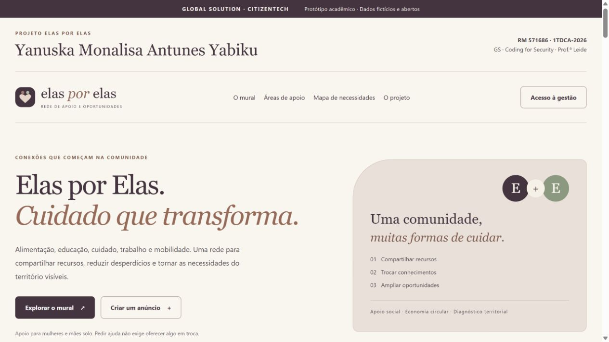

# Elas por Elas

**GS de Coding for Security · CitizenTech · Prof.ª Leide**  
**Responsável acadêmica:** Yanuska Monalisa Antunes Yabiku · **RM 571686**

Uma rede social comunitária para aproximar mulheres e mães solo de alimentação, educação, trabalho, cuidado, mobilidade, direitos e economia circular, com diagnóstico territorial para propostas de projetos públicos. Esta versão evolui o site da disciplina de Linux: os anúncios agora são persistidos em MySQL e compartilhados pela API Flask. Todos os anúncios da entrega são **fictícios**; os municípios e o dado social são públicos.



## Problema, cidadã e CitizenTech

A cidadã considerada é uma mulher da comunidade, especialmente uma mãe solo, que precisa encontrar recursos ou oportunidades com pouco tempo disponível. Ofertas de itens e conhecimentos podem ficar dispersas em canais diferentes. O projeto testa a hipótese de que organizar essas informações por categoria e município facilita a busca por apoio.

O IBGE informa que mulheres dedicavam, em média, **21,3 horas semanais** a cuidados de pessoas e/ou afazeres domésticos em **2022**. O dado contextualiza a sobrecarga de cuidado; não comprova a demanda de um bairro específico nem a eficácia deste sistema. Não foram realizadas entrevistas ou piloto social nesta entrega. [Fonte primária do IBGE](https://educa.ibge.gov.br/jovens/materias-especiais/22052-as-mulheres-do-brasil).

A proposta adapta as frentes de capacitação, inclusão produtiva e participação comunitária do [CitizenTech FIAP](https://experience.fiap.com.br/global-solution-citizen-tech). **São 11 ODS relacionados à versão ampliada: 2, 3, 4, 5, 6, 8, 10, 11, 12, 13 e 16.** ODS do enunciado trabalhados: **2, 3, 4, 10, 11 e 13**. Conexões complementares: **5, 6, 8, 12 e 16**. A relação de cada funcionalidade com os objetivos está em `documentacao/PROJETO_SOCIAL_E_TERRITORIAL.md`; são contribuições propostas, não metas atingidas. Caso a professora classifique este recorte como ideia própria, é necessária a aprovação prevista na atividade.

## O que funciona

- Consultar e filtrar anúncios por texto, tipo, área, município e situação.
- Cadastrar, editar e excluir pela interface e pela API; escrita exige chave de gestão.
- Persistir dados em MySQL com Connector/Python e SQL parametrizado, **sem ORM**.
- Sugerir conexões por categoria, cidade e tipos complementares: pedido e doação abertos.
- Consultar municípios do IBGE com `requests`, JSON, timeout e cache em arquivo por 24 horas.
- Reutilizar cache vencido ou snapshot público de SP quando a fonte externa falhar, indicando essa condição.
- Enviar avisos por **sockets TCP**, receber confirmação e reenviar avisos pendentes.
- Registrar ações e resultados em arquivos com data e hora UTC, sem credenciais ou texto dos anúncios.

## 1. Instalação no Windows com Docker

Requisitos: Python 3.13 com comando `python` disponível e Docker Desktop aberto, usando contêineres Linux. A primeira execução precisa de internet para baixar imagens e dependências. Não é necessário instalar MySQL Workbench.

1. Extraia o ZIP. Entre na pasta que contém `compose.yaml`, `README.md` e `servidor.py`. **Não execute dentro do ZIP.**
2. Abra o PowerShell. Se a pasta está no local combinado, entre com o comando inteiro abaixo, incluindo `cd` e as aspas:

```powershell
cd "C:\Users\yanus\Desktop\GS coding for security\Elas por Elas"
```

3. Gere sua configuração. Esse comando cria `.env`, `logs` e `dados/cache`, sem exibir os segredos e sem substituir um `.env` existente:

```powershell
python preparar.py
```

4. Construa e inicie os três serviços:

```powershell
docker compose up --build -d
```

5. Confira o estado e a inicialização:

```powershell
docker compose ps
docker compose logs --tail=30 web
```

6. Abra **http://127.0.0.1:5055**. O mural inicialmente estará vazio. Para inserir 25 anúncios, dez necessidades fictícias e três malhas municipais públicas:

```powershell
docker compose exec web python povoar_exemplos.py
```

Esse comando insere exemplos somente se o banco estiver vazio. Se já houver registros, ele os preserva. Clique em **Atualizar mural** na página.

7. Para habilitar a gestão, abra a configuração local:

```powershell
notepad .env
```

Copie somente o valor depois de `API_KEY=`. No site, clique em **Acesso à gestão**, cole a chave e clique em **Liberar gestão**. A chave fica apenas na memória da página; recarregar ou fechar a página exige informá-la novamente. Não inclua o `.env` em prints, no ZIP ou no GitHub.

O atalho opcional `iniciar.ps1` executa os passos de configuração e inicialização. Se a política do Windows impedir scripts, use os comandos acima; não é necessário alterar a política do computador.

### Parar e voltar a executar

```powershell
docker compose stop
docker compose start
```

O banco usa um volume persistente. Não use `docker compose down -v` se quiser preservar os anúncios. Alterar a senha no `.env` não altera automaticamente a senha de um banco já inicializado.

## 2. Execução sem Docker

Esta modalidade foi efetivamente validada em Windows com **Python 3.13.12, MySQL Community 8.4.13 e Waitress 3.0.2**. O caminho Docker está preparado para reprodução, mas não foi executado nesta sessão por restrição de acesso ao Docker Desktop.

Instale MySQL Community 8.4 a partir do [site oficial](https://dev.mysql.com/downloads/mysql/8.4.html). Escolha uma porta local disponível. O projeto sugere `3308` para não competir com o CP anterior; se o servidor usar `3306`, ajuste `DB_PORT` no `.env`.

Abra uma sessão administrativa do MySQL e crie um banco exclusivo e um usuário local. No exemplo, substitua a senha pela sua senha longa e aleatória; ela deve ser a mesma de `DB_PASSWORD` no `.env`:

```sql
CREATE DATABASE elas_por_elas CHARACTER SET utf8mb4;
CREATE USER 'elas_app'@'localhost' IDENTIFIED BY 'SUBSTITUA_PELA_SENHA_LOCAL';
GRANT ALL PRIVILEGES ON elas_por_elas.* TO 'elas_app'@'localhost';
```

O privilégio está limitado ao banco da aplicação. A inicialização precisa criar as tabelas; um ambiente de produção deveria separar o usuário de migração do usuário de CRUD.

Na pasta do projeto:

```powershell
python preparar.py
python -m venv .venv
.\.venv\Scripts\python.exe -m pip install -r requirements.txt
```

Não é necessário ativar o ambiente virtual. Ajuste `DB_HOST`, `DB_PORT`, `DB_USER` e `DB_PASSWORD` no `.env` para o servidor criado. Mantenha as chaves geradas pelo preparador.

Abra **dois terminais na pasta do projeto**:

```powershell
# Terminal 1: receptor dos avisos
.\.venv\Scripts\python.exe receptor_tcp.py
```

```powershell
# Terminal 2: servidor web e inicialização das tabelas
.\.venv\Scripts\python.exe servidor.py
```

Em um terceiro terminal, insira os exemplos:

```powershell
.\.venv\Scripts\python.exe povoar_exemplos.py
```

Acesse http://127.0.0.1:5055. Para encerrar, use `Ctrl+C` nos terminais do servidor e do receptor. Não feche esses terminais durante a demonstração.

### Debian ou Ubuntu

Com Python 3.13, suporte a `venv` e MySQL 8.4 instalados, configure o banco como acima e use:

```bash
python3 preparar.py
python3 -m venv .venv
.venv/bin/python -m pip install -r requirements.txt
.venv/bin/python receptor_tcp.py
# Em outro terminal, na mesma pasta:
.venv/bin/python servidor.py
```

O navegador pode ser aberto no próprio Linux. Para acesso entre VMs, a configuração de rede e o endereço de escuta precisam ser definidos para o laboratório. O protótipo não configura DNS, Apache ou firewall e não deve ser exposto à internet em HTTP. A integração com o servidor Linux é uma possibilidade de implantação, não um teste realizado nesta entrega.

## 3. API REST

Base local: `http://127.0.0.1:5055`. Respostas em JSON, exceto exclusão com sucesso. Escritas exigem `X-API-Key`; o corpo de POST e PUT deve usar `Content-Type: application/json`.

| Método e caminho | Finalidade | Sucesso |
|---|---|---|
| `GET /api/anuncios` | Listar e filtrar, 12 registros por página | 200 |
| `POST /api/anuncios` | Criar anúncio | 201 e cabeçalho Location |
| `PUT /api/anuncios/<id>` | Substituir campos e atualizar situação | 200 |
| `DELETE /api/anuncios/<id>` | Excluir anúncio | 204 sem corpo |
| `GET /api/anuncios/<id>` | Consultar um registro | 200 |
| `GET /api/conexoes/<id>` | Sugerir registros complementares | 200 |
| `GET /api/resumo` | Contagens do mural | 200 |
| `GET /api/municipios` | Listar municípios já disponíveis no banco | 200 |
| `GET /api/localidades?uf=SP` | Consultar IBGE/cache e atualizar catálogo | 200 |
| `POST /api/gestao/verificar` | Verificar chave de gestão, sem corpo | 200 |
| `POST /api/notificacoes/reenviar` | Reenviar até 20 avisos pendentes | 200 |
| `GET /api/saude` | Verificar conexão com MySQL | 200 |

Os quatro métodos exigidos estão implementados no recurso `anuncios`. Rotas complementares dão suporte à interface. Filtros aceitos: `tipo`, `categoria`, `status`, `municipio_id`, `busca` e `pagina`. Campos desconhecidos ou repetidos são rejeitados.

Exemplo de JSON para criação:

```json
{
  "titulo": "Livros para uma roda de leitura",
  "tipo": "doacao",
  "categoria": "itens",
  "descricao": "Oferta fictícia de livros em bom estado para uma atividade comunitária.",
  "contrapartida": "",
  "municipio_id": 3548708,
  "status": "aberto"
}
```

Para editar, envie todos esses campos e acrescente `"versao": 1`, usando a versão retornada na consulta mais recente. Cada alteração incrementa a versão; uma edição antiga recebe 409.

| Erro | Uso |
|---|---|
| 400 | Dados, filtros ou JSON inválidos |
| 401 | Chave ausente ou inválida; inclui WWW-Authenticate |
| 403 | Origem de navegador não autorizada |
| 404 | Rota ou anúncio inexistente |
| 405 | Método não implementado |
| 409 | Conflito de versão ao editar |
| 413 | Corpo acima de 16 KiB |
| 415 | Tipo de conteúdo incorreto |
| 429 | Limite de solicitações por minuto |
| 503 | Banco ou fonte sem alternativa disponível |
| 500 | Falha inesperada com mensagem genérica |

## 4. Banco e regra de conexão

`municipios` guarda código IBGE, nome e UF. `anuncios` referencia um município e guarda tipo, categoria, descrição, contrapartida, situação, versão e horários. `notificacoes` guarda eventos técnicos pendentes ou confirmados. `regioes` guarda limites municipais GeoJSON, coordenadas aproximadas, origem e data. `necessidades` guarda setor, prioridade de 1 a 3, natureza da evidência, fonte, situação e versão, com referência ao município. A coluna JSON `anuncios.detalhes` tem esquema validado em Python.

O `INSERT`, `SELECT`, `UPDATE` e `DELETE` estão em `elas/banco.py` e `elas/territorio.py`. Os valores são passados separadamente com `%s`. Transações garantem que anúncio e aviso pendente sejam gravados juntos. Na exclusão, o aviso conserva o identificador numérico do anúncio removido; por isso essa referência na fila não é chave estrangeira.

A conexão sugerida exige mesmo município, situação aberta e tipos complementares, sem prazo encerrado. Cestas, excedentes e marmitas podem se conectar entre si; as outras áreas exigem mesma categoria. A busca retorna até 12 sugestões e não garante listar todos os candidatos. Não há IA, interpretação semântica ou garantia de adequação: dois itens da mesma área podem não atender à mesma necessidade. A interface explica essa limitação.

## 5. Dados externos e arquivos

Fonte: [API de Localidades do IBGE](https://servicodados.ibge.gov.br/api/docs/localidades), endereço fixo `https://servicodados.ibge.gov.br/api/v1/localidades/estados/{UF}/municipios`. Só as 27 siglas permitidas são aceitas. O visitante não escolhe URLs.

`requests.get` usa 3 segundos para conectar e 8 segundos de espera de leitura, sem redirecionamento. A resposta tem limite de 2 MB. Esses timeouts são por conexão/leitura; não são um limite absoluto da duração total do download. Cache de 24 horas em `dados/cache`, com gravação atômica. Uma indisponibilidade usa cache anterior ou, em SP, o snapshot público em `dados/municipios_sp.json`. A resposta informa `origem`, `desatualizado` e data. O snapshot contém 645 municípios consultados de verdade em 05/11/2026.

A tela permite baixar a última resposta como JSON. A evidência `evidencias/consulta_ibge.json` documenta uma execução. Não foi usado scraping, pois a GS exige uma fonte externa e não obriga coleta HTML.

## 6. TCP e logs

`receptor_tcp.py` é um programa independente; `elas/notificacoes.py` é o cliente. JSON por linha, até 4096 bytes, timeout de 2 segundos e token próprio em `.env`. O receptor confirma o UUID recebido. Só metadados técnicos são enviados: identificador do aviso, ação e identificador do anúncio.

O envio ocorre **depois do COMMIT**. Falha deixa o aviso na fila; o botão de gestão faz reenvio em lotes de até vinte. É entrega **pelo menos uma vez**: um ACK perdido pode causar repetição no log. Não há garantia de execução exatamente uma vez. O TCP do laboratório não é cifrado; não publicar a porta na internet. No Docker, ela não é exposta ao computador hospedeiro; no modo nativo, escuta apenas em loopback por padrão na porta 19088.

Arquivos `logs/aplicacao.log` e `logs/tcp.log`: JSON por linha com data/hora UTC, ação, resultado e identificador. Rotação de 1 MB com três cópias. Não contêm chave, corpo dos anúncios ou IP dos visitantes. Amostras sanitizadas estão em `evidencias`.

## 7. Segurança e privacidade

Veja a matriz de três ameaças em [SEGURANCA.md](documentacao/SEGURANCA.md). A aplicação valida tipos, tamanhos, enumerações, IDs e filtros; rejeita HTML e padrões de contatos; protege escritas com chave; compara segredos sem comparação caractere por caractere; restringe origem; aplica cabeçalhos de segurança e limite de chamadas. A interface usa `textContent`.

O modelo é de **uma gestão comunitária de demonstração**, não de contas individuais. A chave de gestão autoriza alterar qualquer anúncio. Consultas são públicas porque só há dados fictícios e abertos. Em operação real seriam necessários contas, papéis, auditoria de responsáveis, moderação, gestão de consentimento quando aplicável, HTTPS e procedimentos de atendimento e exclusão. As barreiras do protótipo não representam certificação de conformidade com a LGPD.

## 8. Testes

Testes unitários e TCP local, sem MySQL de teste:

```powershell
docker compose exec web python verificar.py
```

Para executar também a integração, prepare um banco separado:

```powershell
docker compose exec web python preparar_testes.py
docker compose exec web python verificar.py --integracao
```

No modo nativo, use `.\.venv\Scripts\python.exe` no lugar de `docker compose exec web python`. O `.env` precisa conter a senha administrativa correta em `MYSQL_ROOT_PASSWORD` para `preparar_testes.py`. O servidor web continua usando a conta `elas_app`.

**Atenção ao escopo:** a integração limpa somente as tabelas do banco com sufixo `_teste`. Nunca use esse banco para informações que deseja preservar. O banco principal não é limpo. Sem `--integracao`, os testes MySQL são explicitamente ignorados e isso aparece no relatório.

Resultado verificado desta entrega: **47 testes, zero falhas, zero erros, zero ignorados**, com MySQL real e sockets reais. Os testes de indisponibilidade externa usam falhas controladas, identificadas como tal. Uma consulta real ao IBGE e um ciclo HTTP real foram realizados separadamente. Arquivos: `evidencias/resultado_testes.json` e `evidencias/validacao_http.json`.

## 9. Documentos e evidências

- `documentacao/Relatorio_GS_Elas_por_Elas.pdf`: relatório de até três páginas.
- `documentacao/MATRIZ_REQUISITOS.md`: cada exigência ligada a código e evidência.
- `documentacao/ROTEIRO_EVIDENCIAS.md`: passos e momentos para seus próprios prints.
- `documentacao/SEGURANCA.md`: ameaças, mitigação e limites.
- `documentacao/FONTES_E_AUTORIA.md`: fontes, materiais consultados e declaração de IA.
- `evidencias/`: screenshots reais, JSON de testes, consulta e logs sanitizados.

O guia pessoal de execução e arguição é entregue separadamente do ZIP acadêmico. Ele não substitui o relatório de três páginas.

## 10. GitHub e entrega

Repositório público: [yanuska90/elas-por-elas-gs](https://github.com/yanuska90/elas-por-elas-gs). O arquivo `.gitignore` exclui `.env`, ambientes virtuais, cache, logs de execução e arquivos compactados. Publique o conteúdo desta pasta e não os segredos locais.

O ZIP de entrega contém código, documentação, relatório e evidências. Para refazê-lo depois de novos prints, execute `python empacotar.py`; o script exclui arquivos locais e recusa padrões de nomes ou diretórios de ferramentas de assistência. Verifique o resultado antes de enviar.

## 11. Dificuldades comuns

| Sintoma | O que conferir |
|---|---|
| Caminho não reconhecido no PowerShell | Use `cd` e aspas; não cole só o endereço da pasta |
| Docker mostra erro de conexão | Abra Docker Desktop e aguarde o mecanismo iniciar |
| Porta ocupada | Confirme se outro projeto usa 5055 ou 3308; pare só o serviço correspondente ou ajuste configuração e mapeamento |
| Página não abre | Veja `docker compose ps` e os logs de `web`; aguarde o MySQL inicializar |
| Acesso não autorizado | Cole só o valor de `API_KEY`, sem o nome da variável e sem espaços |
| Banco indisponível | Confira serviço, porta, usuário e senha; não troque o volume por um banco do CP anterior |
| IBGE indisponível | O mural continua disponível; SP tem snapshot público e a interface informa a origem |
| Aviso pendente | Inicie o receptor e use Reenviar avisos pendentes |
| Edição recebe 409 | Reabra o anúncio e edite a versão mais recente |

## 12. Autoria e integração entre disciplinas

Concepção, narrativa e proposta de integração entre disciplinas: Yanuska Monalisa Antunes Yabiku. Utilizei IA como apoio à implementação, documentação e validação técnica.

O projeto busca integrar Coding for Security (Python, API, dados e redes), Linux (execução e serviços), segurança e arquitetura (camadas, acesso e persistência) e a dimensão social do CitizenTech. As conexões conceituais foram propostas pela aluna; não se afirma que todos esses ambientes já foram implantados. Bibliotecas e fontes estão citadas em `documentacao/FONTES_E_AUTORIA.md`.

## 13. Atualizar uma instalação anterior

Na pasta atualizada do projeto, preserve seu `.env` e o volume existente. A migração do banco é automática e aditiva: amplia a categoria e adiciona detalhes, regiões e necessidades. Não apaga os anúncios existentes.

```powershell
docker compose up --build -d
docker compose exec web python povoar_exemplos.py --complementar
```

O segundo comando inclui apenas títulos de exemplo ausentes. Ele não renova prazos de anúncios já cadastrados: edite esses prazos quando necessário. Depois atualize a página com `Ctrl + F5`. No modo nativo, reinicie o servidor e use `.\.venv\Scripts\python.exe povoar_exemplos.py --complementar`.

## 14. Diagnóstico territorial e propostas públicas

1. Abra **Mapa de necessidades**. A demonstração começa com dez demandas fictícias em São Bernardo do Campo, São Paulo e Diadema.
2. Escolha município e setor: educação, segurança, alimentação, moradia, saneamento, transporte, saúde, lazer, ambiente ou trabalho.
3. Com a gestão liberada, use **Registrar necessidade**. Informe título, descrição geral, prioridade, situação e natureza. Não cadastre endereço residencial, renda, nome ou caso pessoal.
4. Para natureza **dado público**, informe fonte governamental HTTPS, sem credenciais, parâmetros ou fragmento. O sistema valida o endereço, mas a gestão precisa ler a fonte e verificar se ela comprova a demanda no território. Um dado nacional não prova carência municipal.
5. **Carregar geografia do município selecionado** consulta a API de malhas do IBGE. Há cache MySQL de 24 horas e cópia pública de três cidades para contingência. Outros municípios dependem de uma primeira consulta bem-sucedida. É possível carregar municípios de outra UF na seção de localidades.
6. **Baixar relatório JSON** exporta o recorte atual. **Imprimir minuta / PDF** mostra a minuta na página para revisão. Em seguida, clique **Imprimir esta minuta** e escolha **Salvar como PDF** na impressão do navegador. O relatório lista setores, pendências, prioridades atribuídas e sugestões iniciais de projetos.
7. Revise fontes, duplicidades, órgão competente, orçamento e participação da comunidade antes de um eventual protocolo. A aplicação não transmite nada ao governo. Uma minuta fictícia recebe a indicação **SIMULAÇÃO ACADÊMICA - NÃO PROTOCOLAR**.

O mapa usa limites municipais simplificados, não bairros, ruas ou GPS das participantes. Coordenadas são o centro do retângulo da malha, não a sede oficial. Cor indica presença de registros no recorte; números na legenda indicam quantidades. Não é mapa de criminalidade nem medida de pessoas em vulnerabilidade. No máximo 1.000 necessidades são consideradas por recorte; `truncado` indica excesso e exige refinar os filtros.

| Método e caminho adicional | Função | Sucesso |
|---|---|---|
| GET /api/catalogo | Áreas, orientações e ODS | 200 |
| GET /api/necessidades | Filtros municipio_id, setor, natureza | 200 |
| POST /api/necessidades | Criar necessidade com gestão | 201 + Location |
| GET /api/necessidades/&lt;id&gt; | Consultar necessidade | 200 |
| PUT /api/necessidades/&lt;id&gt; | Editar com versão | 200; versão antiga 409 |
| DELETE /api/necessidades/&lt;id&gt; | Excluir com gestão | 204 |
| GET /api/regioes | Malhas já salvas | 200 |
| POST /api/regioes/&lt;id&gt;/localizar | Consultar/cache geografia; sem corpo | 200 |
| GET /api/diagnostico | Agrupar recorte por município e setor | 200 |

Exemplo de necessidade fictícia:

```json
{"municipio_id":3548708,"setor":"educacao","titulo":"Oficinas educativas demonstrativas","descricao":"Simulação de uma demanda municipal para estudar a ampliação de oficinas.","prioridade":2,"natureza":"simulado","fonte_url":"","status":"registrada"}
```

Na edição, acrescente `versao` com o número retornado pela API. `natureza` admite `simulado` ou `dado_publico`, sem misturá-los no relatório. Status: `registrada`, `em_analise`, `encaminhada`, `concluida`. Encaminhada é anotação da gestão; não significa envio automático.

## 15. Campos das novas áreas

`detalhes` permite somente quantidade, unidade, disponivel_ate, cuidados, origem e destino. Quantidade é inteira positiva; unidades: unidade, kg, litro, porcao, vaga, hora. O prazo usa UTC no formato `AAAA-MM-DDTHH:MM:SSZ`; a tela converte a hora local.

- **Doação/oferta de alimentos, excedentes e marmitas:** quantidade, unidade compatível, prazo futuro e condições de conservação/ingredientes são obrigatórios. O sistema não certifica segurança sanitária nem decide se um alimento é próprio para consumo.
- **Caronas:** origem e destino são regiões gerais; data/hora obrigatória. Ofertas têm de 1 a 8 vagas. Não coleta endereços residenciais, verifica condutores ou agenda viagens.
- **Recicláveis, óleo, compostagem e hortas:** ofertas exigem condições de separação, aceitação ou coleta. A destinação efetiva requer confirmação do responsável.
- **Jurídico e saúde:** divulgação e encaminhamento informativo; sem relatos sensíveis, consulta individual ou permuta profissional.

Os prazos dos exemplos são gerados sete dias após sua primeira carga. Após vencerem, aparecem como prazo encerrado e deixam de gerar sugestões. Nenhum cadastro de teste comprova entrega, emprego, atendimento ou impacto ambiental.
